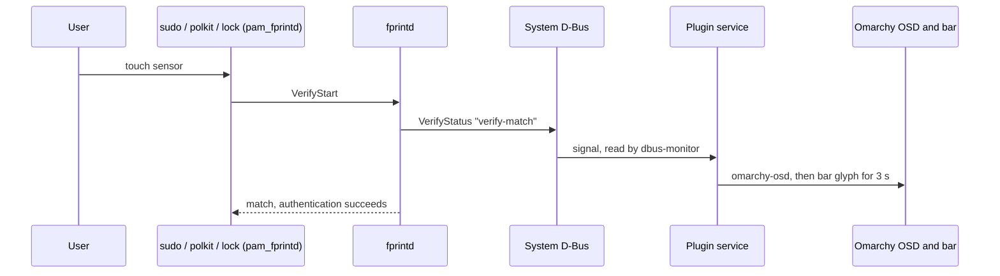

# Fingerprint feedback for Omarchy

An [Omarchy](https://omarchy.org/) shell plugin that shows when a fingerprint is
accepted or rejected.

Omarchy's lock screen and polkit dialog already show fingerprint states, but
`sudo` in a terminal does not: `pam_fprintd` stays silent when a finger unlocks
it. This plugin fills that gap everywhere fprintd is used:

- an OSD toast, "Fingerprint OK" or "Fingerprint not recognised";
- an optional bar widget that flashes a fingerprint glyph for 3 seconds, in the
  bar's urgent colour when the finger is rejected.

## How it works

fprintd broadcasts a `VerifyStatus` signal on the system D-Bus after each scan.
The plugin's service runs `dbus-monitor` inside the Omarchy shell, reads
`verify-match` and `verify-no-match`, and calls `omarchy-osd`. The bar widget
reads the last result from the service.



No root access and no extra package: `dbus-monitor` ships with `dbus`, which
every Omarchy install has, and fprintd's signals are readable by any user.

## Requirements

- Omarchy with the Quickshell-based shell
- Fingerprint authentication set up: `omarchy setup security fingerprint`

## Install

```bash
omarchy plugin add https://github.com/kbsali/omarchy-fingerprint-feedback --enable
```

The service starts with the shell. To show the bar widget, place it in the bar:

```bash
omarchy plugin enable kbsali.fingerprint-feedback --section right
```

Update with `omarchy plugin update kbsali.fingerprint-feedback`, remove with
`omarchy plugin remove kbsali.fingerprint-feedback`.

## Test

```bash
sudo -k; sudo true
```

Touch the sensor: the OSD shows "Fingerprint OK". Try an unenrolled finger to
see the rejected state.

## License

MIT
