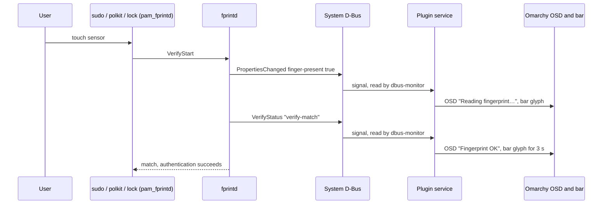

# Fingerprint feedback for Omarchy

An [Omarchy](https://omarchy.org/) shell plugin that shows when a fingerprint is
being read, then whether it is accepted or rejected.

Omarchy's lock screen and polkit dialog already show fingerprint states, but
`sudo` in a terminal does not: `pam_fprintd` stays silent when a finger unlocks
it. This plugin fills that gap everywhere fprintd is used:

- an OSD toast as soon as the finger touches the sensor, "Reading fingerprint…",
  replaced by the result: "Fingerprint OK", "Fingerprint not recognised", or
  "Scan failed, try again" when the sensor could not read the finger;
- an optional bar widget that shows a fingerprint glyph from the touch until 3
  seconds after the result, in the bar's urgent colour when the finger is
  rejected or the scan failed.


## How it works

fprintd broadcasts 2 signals on the system D-Bus: a `PropertiesChanged` on its
`finger-present` property as soon as a finger touches the sensor, then a
`VerifyStatus` signal with the result. The plugin's service runs
`dbus-monitor` inside the Omarchy shell, reads both, and calls `omarchy-osd`.
The bar widget reads the last state from the service.



No root access and no extra package: `dbus-monitor` ships with `dbus`, which
every Omarchy install has, and fprintd's signals are readable by any user.

## Requirements

- Omarchy with the Quickshell-based shell
- Fingerprint authentication set up: `omarchy setup security fingerprint`

## Install

Listed in the [Omarchy plugin directory](https://plugins.omarchy.org/plugin.html?id=kbsali.fingerprint-feedback).

```bash
omarchy plugin add https://github.com/kbsali/omarchy-fingerprint-feedback --enable
```

The service starts with the shell. To show the bar widget, place it in the bar:

```bash
omarchy plugin enable kbsali.fingerprint-feedback --section right
```

Update with `omarchy plugin update kbsali.fingerprint-feedback`, remove with
`omarchy plugin remove kbsali.fingerprint-feedback`.

## Test

```bash
sudo -k; sudo true
```

Touch the sensor: the OSD shows "Reading fingerprint…", then "Fingerprint OK". Try an unenrolled finger to
see the rejected state.

## License

MIT
